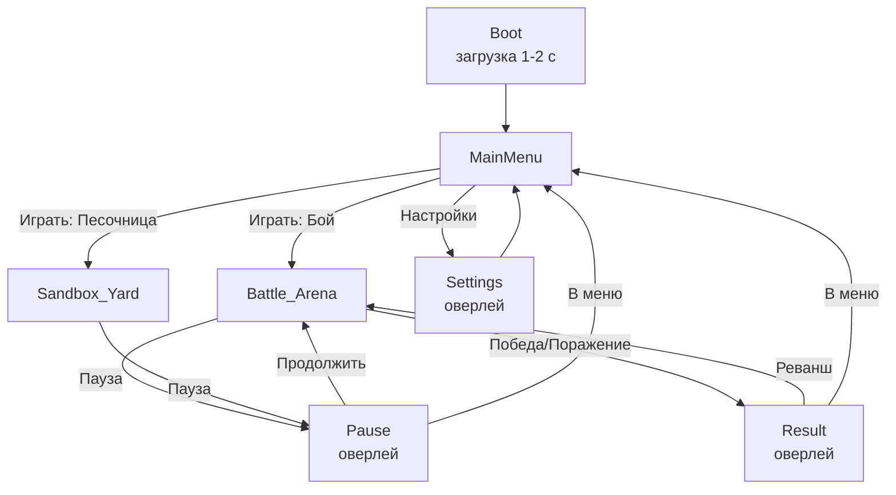
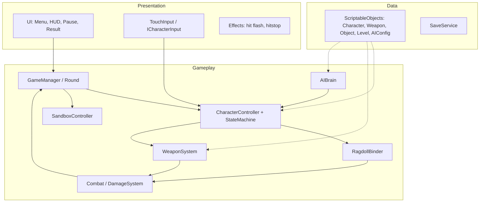

# ТЕХНИЧЕСКОЕ ЗАДАНИЕ
## Physics Stickman Playground («Stickman Fight»)

| Поле | Значение |
|---|---|
| Версия документа | 1.0 |
| Статус | На согласование с командой |
| Дата | 20.11.2026 |
| Основание | Черновик `ТЗ.txt` (исходный набросок), дополнен и уточнён |
| Тип продукта | 2D physics sandbox / fighting game, мобильный прототип |
| Платформа | Android 7.1+ (API 25+), landscape, оффлайн |
| Движок | Unity 6.3 LTS (6000.3.x), 2D, Built-in Render Pipeline — см. раздел 7 и Приложение Б |
| Срок | 30 календарных дней (≈ 21 рабочий день) — ориентир, не жёсткий дедлайн: план задаёт порядок этапов |
| Команда | Мулюков Рафаэль, Уали Рахметолла, Нуртазин Салахуддин |
| Объём v1.0 | 2 режима, 2 локации, 1 персонаж, 1 тип противника, 3 оружия, 4 типа объектов |
| Главный принцип | Работающий прототип важнее полноты функций |

---

## 0. Как читать этот документ

**Приоритеты требований (MoSCoW):**

| Метка | Значение | Правило |
|---|---|---|
| **MUST** | Обязательно для v1.0 | Без этого проект не принимается |
| **SHOULD** | Желательно | Реализуется, если остаётся время; режется первым при отставании |
| **COULD** | Опционально | Только после полного закрытия MUST и SHOULD |
| **WON'T** | Явно вне рамок v1.0 | Задокументировано в разделе 14, чтобы не было споров |

**Идентификаторы требований:** `FR-<модуль>-<номер>` для функциональных, `NFR-<область>-<номер>` для нефункциональных, `TC-<номер>` для тест-кейсов, `RISK-<номер>` для рисков, `Q-<номер>` для открытых вопросов.

**Критерий приёмки (AC)** — проверяемое утверждение. Если требование нельзя проверить руками за 2 минуты или автотестом, оно переформулировано.

**Соглашение о числах:** все числовые значения в разделе 8 — стартовые для настройки (baseline), а не догма. Их разрешено и нужно менять по результатам плейтестов, но только в одном месте (ScriptableObject-конфиги, см. ADR-4).

---

## 1. Цель, рамки, успех

### 1.1. Идея продукта

2D-игра про человечков-стикменов с честной физикой ragdoll, где игрок:
1) дерётся с противником на арене, используя оружие и физику окружения;
2) в режиме песочницы свободно ставит объекты, таскает их, бросает и наблюдает за физическими взаимодействиями.

### 1.2. Цель проекта (SMART)

За 30 календарных дней получить устанавливаемый на реальный Android-смартфон APK, в котором:

- есть главное меню и два играбельных режима;
- персонаж управляется с сенсорного экрана и физически взаимодействует с миром;
- противник с простым ИИ способен довести бой до победы или поражения;
- работают три вида оружия и система здоровья;
- стабильные 60 FPS на референсном устройстве и отсутствие критических багов.

### 1.3. Целевая аудитория

| Параметр | Значение |
|---|---|
| Возраст | 12–25 лет |
| Тип игрока | Casual, играет короткими сессиями 2–5 минут |
| Ожидание | «Смешно и физично», мгновенный вход без обучения |
| Контекст | Один палец/два пальца, вертикальный хват телефона не предполагается (игра landscape) |

### 1.4. Что входит в рамки v1.0 (In scope)

- Один тип персонажа (стикмен) для игрока и противника, отличаются цветом.
- Режим «Бой»: 1 игрок против 1 ИИ, арена, победа по обнулению здоровья, раунды.
- Режим «Песочница»: спавн объектов, перетаскивание, бросок, физика, до 60 динамических тел.
- Три оружия: меч, молот, пистолет.
- Четыре типа объектов: ящик, металлический блок, мяч, второй стикмен (управляемый болванчик).
- Две локации: арена и песочница.
- Меню, HUD, пауза, экран результата, минимальные настройки (звук, вибро, размер кнопок).
- Минимальный звук (удары, выстрел, попадание, победа) — **SHOULD**.
- Сохранение только настроек через `PlayerPrefs` (**MUST**), прогресс не сохраняется.

### 1.5. Что не входит (Out of scope v1.0)

Онлайн-мультиплеер, сюжет, кампания, магазин, реклама, IAP, аналитика, облачные сохранения, редактор уровней, более 1 типа ИИ, более 1 персонажа по характеристикам, кровь/расчленение, погодные эффекты, day/night, разрушаемое окружение сложнее ящика, инвентарь более 1 слота, достижения, локализация на другие языки (архитектурно — да, фактически — RU).

### 1.6. Критерии успеха прототипа

| ID | Критерий | Как измеряем |
|---|---|---|
| KPI-1 | Новый игрок понимает управление без объяснений | 5 из 5 тестеров начали двигаться за ≤ 15 с |
| KPI-2 | Бой занимает 20–60 с и заканчивается победой или поражением | 3 из 3 тестовых боёв в этом диапазоне |
| KPI-3 | Песочница «залипательна» ≥ 3 минуты без постановки задачи | 1 сессия ≥ 3 мин у 3 из 5 тестеров |
| KPI-4 | Нет падений и зависаний за 15 минут непрерывной игры | 0 крашей, 0 фризов > 1 с |
| KPI-5 | Сборка ставится на чистое устройство | Установка APK без ошибок на 2 разных телефонах |

### 1.7. Что изменено относительно исходного черновика

Ниже — все содержательные правки. Черновик не выбрасывался: его требования сохранены (трассировка — Приложение Д).

| № | Было в черновике | Стало в ТЗ | Причина |
|---|---|---|---|
| 1 | «Ragdoll-физика» как единое требование | Разделено на «персонаж» (FR-CHAR) и «ragdoll» (FR-RAG), выбран гибридный подход (ADR-1) | Полностью «активный ragdoll» для боя за 30 дней нестабилен и неуправляем; нужен конкретный технический выбор |
| 2 | Нет числовых параметров | Раздел 8: HP, массы, скорости, урон, кулдауны, лимиты | Без чисел невозможно ни реализовать, ни балансировать, ни тестировать |
| 3 | Нет критериев приёмки по функциям | У каждого FR — блок AC с измеримыми условиями | Иначе «сделано» — вопрос вкуса |
| 4 | Управление перечислено списком | Раздел 9: раскладка, размеры кнопок в dp, мультитач, зоны, safe area | На телефоне «кнопка есть» ≠ «в неё попадаешь» |
| 5 | Нет архитектуры | Раздел 7: слои, папки, ADR-решения, матрица коллизий, формулы | Без архитектуры 30 дней уйдут на переделки |
| 6 | «Кнопка выбора/смены оружия» + «подбирать оружие» конфликтуют | Один слот в руках; кнопка = выбросить/подобрать; смена оружия = подойти к другому | Убирает необходимость в инвентаре и UI выбора, экономит 2–3 дня |
| 7 | Система здоровья без модели урона | FR-COMBAT: урон от импульса + урон оружия, hitstop, нокбэк, стан, кулдаун попадания | Иначе 8 конечностей наносят урон 8 раз за один удар |
| 8 | «Нет сохранений» без уточнения | Сохранение настроек обязательно, игровой прогресс — нет | Настройки без сохранения бесят игрока, а полноценные сейвы не нужны |
| 9 | ИИ упомянут одной строкой | FR-AI: FSM из 6 состояний, 3 пресета сложности, лимиты | Иначе ИИ либо не работает, либо неубиваем |
| 10 | План на 30 дней без проверок | 8 спринтов с Gate-критериями и обязательной сборкой APK каждые 3–4 дня | Отсутствие ранней сборки — риск №1 в мобильной разработке |
| 11 | Нет нефункциональных требований | NFR: FPS, память, размер APK, cold start, API level, ABI | Игра может «работать» на ПК и не работать на телефоне |
| 12 | Нет тестирования и приёмки | Раздел 12: 25 тест-кейсов, автотесты, матрица устройств, DoD | Нечего предъявлять на защите |
| 13 | Нет управления рисками | Раздел 13: 10 рисков с триггерами и fallback | 30 дней не терпят сюрпризов |
| 14 | Нет правил изменения объёма | Раздел 14: cut list в фиксированном порядке | Защита от «а давайте ещё…» |

---

## 2. Глоссарий

| Термин | Определение |
|---|---|
| **Ragdoll** | Физическая модель персонажа из нескольких тел (Rigidbody2D), соединённых шарнирами; поведение определяется физикой, а не анимацией |
| **Активный ragdoll** | Управление ragdoll через моменты силы на суставах (максимально «живо», но сложно стабилизировать) |
| **Гибридный персонаж** | Тело-капсула с физикой + стабилизация вертикали + физические конечности; при нокдауне превращается в полный ragdoll (принято в проекте, ADR-1) |
| **Knockdown** | Состояние, когда персонаж теряет вертикаль и падает; управление блокируется до подъёма |
| **Hitstop** | Короткая (40–70 мс) остановка времени в момент попадания для «веса» удара |
| **Импульс** | Физическая величина силы удара; в Unity — `Rigidbody2D.AddForce(..., ForceMode2D.Impulse)`, единица: Н·с |
| **Fixed timestep** | Шаг физики; в проекте зафиксирован на 1/60 с |
| **Vertical slice** | Готовый на 100% кусок игры (один полный бой), а не набор недоделанных систем |
| **Safe area** | Область экрана без вырезов, скруглений и системных полос |
| **dp** | Density-independent pixel — независимая от плотности единица размера UI в Android |
| **DoD** | Definition of Done — критерии, при которых задача считается выполненной |
| **IL2CPP** | Режим компиляции Unity в C++ (нужен для 64-бит Android) |
| **AAB / APK** | Форматы пакета Android: APK — для установки и тестов, AAB — для Google Play |

---

## 3. Игровая концепция

### 3.1. Elevator pitch

«Стикмен на честной физике: дерись молотом и мечом на арене, а потом переверни всё в песочнице. Всё, что ты видишь, подчиняется физике — включая тебя самого.»

### 3.2. Core loop

**Бой (2–5 минут):**
`Меню → выбор сложности → арена → сближение → удары/оружие → нокдаун противника → добивание → экран победы → реванш`

**Песочница (свободный):**
`Меню → песочница → спавн объектов → комбинирование/бросок → наблюдение за физикой → очистка сцены`

### 3.3. Столпы дизайна (проверка каждого решения)

1. **Физика честная.** Всё, что двигается, движется по физике; нет «залипших» анимаций, персонаж падает, если его толкнули.
2. **Управление читается за 10 секунд.** Пять кнопок, каждая — одно действие, без комбинаций.
3. **Удар ощущается.** Hitstop + нокбэк + звук дают «вес» даже при минимальной графике.
4. **Прототип, а не игра-сервис.** Нет мета-прогрессии, магазина, ежедневных наград.

### 3.4. Референсы и что именно берём

| Референс | Берём | Не берём |
|---|---|---|
| Supreme Duelist Stickman | Дуэль 1×1 на фоне, оружие в руке, простая арена | Магазин, много оружия, боссы |
| People Playground | Свободный спавн объектов, перетаскивание, физические эксперименты | Сложные механизмы, кровь, расчленение, редактор |
| Getting Over It / Human Fall Flat | «Неустойчивый» персонаж, ощущение веса | Управление мышью, длинные уровни |

---

## 4. Структура приложения

### 4.1. Карта экранов



### 4.2. Сцены Unity

| Файл | Назначение | Что содержит |
|---|---|---|
| `00_Boot.unity` | Инициализация | GameManager (DontDestroyOnLoad), загрузка настроек, прогрева пула |
| `10_MainMenu.unity` | Меню | Заголовок, 3 кнопки, версия, фон |
| `20_Battle_Arena.unity` | Бой | Арена, спавн-точки, HUD, ИИ |
| `30_Sandbox_Yard.unity` | Песочница | Плоское поле, панель инструментов, HUD |

Оверлеи (Pause, Result, Settings) — не сцены, а префабы Canvas, чтобы не терять состояние игры.

### 4.3. Навигация и системные кнопки

- **FR-CORE-01 (MUST).** Кнопка «Back» Android: в меню — выход с подтверждением; в игре — открыть паузу; в паузе — закрыть паузу; в настройках — вернуться.
- **FR-CORE-02 (MUST).** Жизненный цикл: при сворачивании (`OnApplicationPause`) игра ставится на паузу; звук выключается; при возврате не возобновляется автоматически (показывается оверлей паузы).
- **FR-CORE-03 (MUST).** Ориентация жёстко landscape (left/right), immersive mode (скрыть системные панели), без перезагрузки сцены при повороте.
- **FR-CORE-04 (MUST).** Выход из игры (`Application.Quit`) с подтверждающим диалогом, чтобы случайный свайп не закрыл игру.

**AC:** после 3 поворотов устройства сцена не перезагружается; после сворачивания на 2 минуты игра на паузе и продолжает корректно.

### 4.4. Версионирование

- `Application.version` = `0.1.<build>`; номер билда подставляется из `BuildInfo` при сборке.
- В главном меню отображается версия и дата сборки (MUST — упрощает баг-репорты).

---

## 5. Функциональные требования

### 5.1. Ядро и игровой процесс (FR-CORE)

| ID | Требование | Пр. |
|---|---|---|
| FR-CORE-05 | Единая точка входа `GameManager` с состоянием `Boot / Menu / Playing / Paused / RoundOver`, переходы только через неё | MUST |
| FR-CORE-06 | Игровое время подчиняется `Time.timeScale`; пауза = `timeScale = 0`, hitstop = временное `timeScale = 0.02` на 40–70 мс с восстановлением | MUST |
| FR-CORE-07 | Раунд: бой до победы одной из сторон; таймаут 90 с — при равенстве HP победа присуждается по большему остатку здоровья, иначе ничья | MUST |
| FR-CORE-08 | Экран результата: результат, статистика (нанесено/получено урона), кнопки «Реванш», «В меню» | MUST |
| FR-CORE-09 | Рестарт сцены без утечек: объекты уничтожаются через пул/`Destroy`, подписки на события отписываются | MUST |
| FR-CORE-10 | Настройки (громкость, вибро, размер кнопок, сложность) сохраняются между запусками | MUST |

**AC:**
- Перезапуск сцены 5 раз подряд: количество `Rigidbody2D` и `AudioSource` на сцене не растёт (проверка в Profiler).
- После выхода из боя в меню и повторного входа бой начинается с полным HP и нулевым таймером.

### 5.2. Персонаж: движение и стойка (FR-CHAR)

| ID | Требование | Пр. |
|---|---|---|
| FR-CHAR-01 | Персонаж собран из тела (капсула, `Rigidbody2D` dynamic) и 5 визуально-физических частей: голова, 2 руки, 2 ноги | MUST |
| FR-CHAR-02 | Движение влево/вправо: целевая скорость 4.5 м/с, ускорение 30 м/с², разворот спрайта по направлению | MUST |
| FR-CHAR-03 | Прыжок: импульс 7.5 м/с, только с земли, coyote time 0.1 с, jump buffer 0.12 с | MUST |
| FR-CHAR-04 | Устойчивость: пока персонаж не в knockdown, корпус стабилизируется к вертикали моментом силы (ADR-1), с максимумом угла 45° | MUST |
| FR-CHAR-05 | Проверка земли: `OverlapCircle`/`Raycast` под ногами, слой `Ground`, без ложных срабатываний на стенах | MUST |
| FR-CHAR-06 | Перемещение по склонам и небольшим уступам (до 0.3 м) без застревания | SHOULD |
| FR-CHAR-07 | Изменение масштаба и цвета: игрок — голубой, противник — красный, болванчик в песочнице — серый | MUST |
| FR-CHAR-08 | Персонаж не может «провалиться» сквозь пол при любых скоростях (Continuous Collision Detection на теле) | MUST |

**AC:**
- Зажать «вправо» на 5 с: персонаж перемещается ≈22 м (±10%) и не опрокидывается.
- Прыжок с места: высота 1.2–1.6 м, приземление без проваливания.
- Персонаж стоит 30 с без ввода: угол корпуса к вертикали < 15° в 95% кадров.

### 5.3. Ragdoll и состояния персонажа (FR-RAG)

| ID | Требование | Пр. |
|---|---|---|
| FR-RAG-01 | Конечности — отдельные `Rigidbody2D` на `HingeJoint2D` с лимитами углов; коллизии между частями одного персонажа отключены | MUST |
| FR-RAG-02 | Состояния: `Standing`, `Moving`, `Airborne`, `Attacking`, `Stunned`, `Knockdown`, `Dead`; переходы — через конечный автомат, без «залипаний» | MUST |
| FR-RAG-03 | Переход в `Knockdown` при импульсе на корпус > 12 Н·с или уроне за один хит > 25 | MUST |
| FR-RAG-04 | В `Knockdown` стабилизация отключается, управление блокируется, персонаж падает по физике | MUST |
| FR-RAG-05 | Подъём: через 0.9 с при отсутствии повторных ударов; анимация подъёма — плавный интерполяционный возврат к вертикали (0.35 с), неуязвимость 0.35 с | MUST |
| FR-RAG-06 | `Dead`: полное ragdoll-обмякание, управление и ИИ отключены; труп остаётся на арене до конца раунда | MUST |
| FR-RAG-07 | Стан: 0.35 с, в это время нет управления, но физика активна; визуальный индикатор (мигание) | MUST |
| FR-RAG-08 | Ограничение количества частей ragdoll: не более 6 тел на персонажа (производительность) | MUST |
| FR-RAG-09 | Персонаж не «дрожит» и не самопроизвольно падает при спокойном стоянии на ровной поверхности | MUST |

**AC:**
- Бросить мяч в стоящего персонажа: он реагирует, но не падает при слабом ударе и падает при сильном (порог в конфиге).
- Уронить персонажа с высоты 3 м: он переходит в knockdown, через 0.9 с поднимается и снова управляем.
- 100 циклов «удар молотом» в автотесте: 0 случаев «застрял в knockdown навсегда».

### 5.4. Бой и урон (FR-COMBAT)

| ID | Требование | Пр. |
|---|---|---|
| FR-COMBAT-01 | Урон наносится только через `DamageSystem` (единая точка): источники — оружие, снаряд, столкновение, падение | MUST |
| FR-COMBAT-02 | Кулдаун попадания по цели от одного источника: 0.25 с (защита от мультиудара конечностями) | MUST |
| FR-COMBAT-03 | Формула урона от оружия: `damage = baseDamage * clamp(relSpeed / refSpeed, 0.5, 1.5)` | MUST |
| FR-COMBAT-04 | Урон от падения: `damage = max(0, (impulse - fallDamageThreshold) * fallDamageK)`, `fallDamageThreshold` = 15 Н·с, `fallDamageK` = 0.35 | MUST |
| FR-COMBAT-05 | Нокбэк: импульс в направлении удара, сила = `weapon.impulse`, с затуханием | MUST |
| FR-COMBAT-06 | Hitstop 40–70 мс на попадании, только для попаданий по персонажу | MUST |
| FR-COMBAT-07 | HP 100, без регенерации в бою; в песочнице — без ограничений (болванчик не умирает, `GodMode`-опция) | MUST |
| FR-COMBAT-08 | Смерть при HP ≤ 0 → `Dead` → через 1.5 с экран результата | MUST |
| FR-COMBAT-09 | Индикация попадания: вспышка цвета персонажа + всплывающая цифра урона | SHOULD |
| FR-COMBAT-10 | Дружественный огонь отсутствует (урон только по противнику и объектам) | MUST |

**AC:**
- Один удар мечом наносит 14–21 урона (базовые 18 ± допуск) и ровно один раз за взмах.
- Удар молотом на скорости персонажа даёт урон выше, чем стоя на месте (соотношение ≥ 1.2).
- Три удара молотом подряд сбивают противника в knockdown, но не убивают (HP > 0).

### 5.5. Оружие (FR-WEAP)

| ID | Требование | Пр. |
|---|---|---|
| FR-WEAP-01 | Оружие — физический объект с `Rigidbody2D`, которое можно подобрать при касании и нажатии «Взаимодействие» | MUST |
| FR-WEAP-02 | В руках может быть одновременно только 1 оружие; при подборе нового текущее выбрасывается | MUST |
| FR-WEAP-03 | Оружие в руке следует за рукой через `FixedJoint2D`/иерархию с сохранением физики удара | MUST |
| FR-WEAP-04 | Бросок оружия: кнопка «Взаимодействие» удерживается 0.3 с при наличии оружия (SHOULD); импульс броска 8 Н·с | SHOULD |
| FR-WEAP-05 | Меч: взмах по дуге 100°, hit-window 0.18 с, кулдаун 0.45 с | MUST |
| FR-WEAP-06 | Молот: урон зависит от скорости, кулдаун 0.9 с, высокий нокбэк | MUST |
| FR-WEAP-07 | Пистолет: снаряд 22 м/с, магазин 6 патронов, перезарядка 1.4 с, кулдаун выстрела 0.35 с | MUST |
| FR-WEAP-08 | Снаряд: урон 12, живёт 2 с, уничтожается при попадании в объект/персонажа/границу | MUST |
| FR-WEAP-09 | Оружие можно найти на арене в 3 фиксированных точках (респавн через 12 с после подбора) | MUST |
| FR-WEAP-10 | Оружие наносит физические столкновения объектам (может сбить ящик) | SHOULD |

**AC:**
- Подойти к мечу и нажать «Взаимодействие»: меч в руке, руки визуально держат его, при взмахе слышен/виден эффект и наносится урон.
- Выстрел из пистолета: 6 выстрелов → автоматическая перезарядка → снова 6.
- Стрельба в стену не наносит урон персонажам и не «залипает» в ней.

### 5.6. Противник и ИИ (FR-AI)

| ID | Требование | Пр. |
|---|---|---|
| FR-AI-01 | ИИ управляет тем же персонажем через тот же интерфейс ввода, что и игрок (`ICharacterInput`) — никаких «читерских» телепортов и прямых изменений позиции | MUST |
| FR-AI-02 | Конечный автомат: `Idle → Approach → Attack → Reposition → Stunned → Dead` | MUST |
| FR-AI-03 | Реакция: задержка принятия решения (reaction time) 0.35 с на Normal | MUST |
| FR-AI-04 | Атака при дистанции < 1.0 м; кулдаун атаки 0.6 с на Normal, увеличенный на 40% при реакции 0.6 | MUST |
| FR-AI-05 | ИИ подбирает оружие, если оно в радиусе 3 м и он без оружия | SHOULD |
| FR-AI-06 | ИИ отступает при HP < 30% и ждёт перезарядки пистолета | SHOULD |
| FR-AI-07 | Три пресета сложности: Easy / Normal / Hard (только через параметры, без отдельного кода) | MUST |
| FR-AI-08 | ИИ не застревает в углах: при отсутствии прогресса 2 с — смена направления | MUST |
| FR-AI-09 | ИИ не «побеждает мгновенно»: победа Normal-ИИ над новичком в 40–70% боёв | MUST |

**AC:**
- Easy-ИИ проигрывает новичку в большинстве боёв; Hard — выигрывает.
- ИИ 10 минут подряд не застревает в геометрии (спавн в 4 разных точках).

### 5.7. Режим песочницы (FR-SANDBOX)

| ID | Требование | Пр. |
|---|---|---|
| FR-SANDBOX-01 | Панель инструментов: создать ящик / блок / мяч / стикмена / оружие | MUST |
| FR-SANDBOX-02 | Тап по объекту — выделение (подсветка контура) | MUST |
| FR-SANDBOX-03 | Перетаскивание выделенного объекта — перемещение через физический «mouse joint» (объект следует за пальцем, но сталкивается с миром) | MUST |
| FR-SANDBOX-04 | Кнопка «Удалить» — удаляет выделенный объект; кнопка «Очистить» — удаляет все созданные объекты | MUST |
| FR-SANDBOX-05 | Лимит: не более 60 динамических тел и 8 персонажей; при превышении — старейший объект удаляется с уведомлением | MUST |
| FR-SANDBOX-06 | Спавн происходит в точке тапа на земле, без пересечения с существующими телами (проверка `OverlapCircle`, при занятости — смещение) | MUST |
| FR-SANDBOX-07 | Свободная камера: перетаскивание двумя пальцами (пан) и щипок (зум 0.6–2.0) | SHOULD |
| FR-SANDBOX-08 | Кнопка «Замедление» (0.3×) для разглядывания физики | COULD |
| FR-SANDBOX-09 | Стрельба/удар по созданным объектам работает так же, как в бою | MUST |

**AC:**
- Спавн 60 ящиков: FPS не падает ниже 30 на референсном устройстве; при 61-м первый исчезает.
- Перетаскивание мяча не проходит сквозь стену; при отпускании мяч летит по инерции.
- Удар молотом по металлическому блоку не разрушает его, по ящику — разрушает (если включено FR-SANDBOX-10).

| ID | Требование | Пр. |
|---|---|---|
| FR-SANDBOX-10 | Ящик разрушается при импульсе > 40 Н·с на 4 осколка | COULD |

### 5.8. Локации (FR-LEVEL)

| ID | Требование | Пр. |
|---|---|---|
| FR-LEVEL-01 | Арена: плоская поверхность длиной 40 м, стены по краям высотой 6 м, невидимый потолок | MUST |
| FR-LEVEL-02 | Песочница: плоское поле 60 × 20 м, стены по краям, без противников | MUST |
| FR-LEVEL-03 | Точки спавна игрока и противника на расстоянии 6 м друг от друга | MUST |
| FR-LEVEL-04 | Декоративные элементы (2–4 силуэта на фоне, параллакс) | COULD |
| FR-LEVEL-05 | Разные фоны у арены и песочницы (цвет/силуэты) для визуального различия | SHOULD |

**AC:** персонаж не может выйти за границы карты ни пешком, ни прыжком, ни будучи отброшенным.

### 5.9. Интерфейс (FR-UI)

| ID | Требование | Пр. |
|---|---|---|
| FR-UI-01 | Главное меню: заголовок, «Бой», «Песочница», «Настройки», версия | MUST |
| FR-UI-02 | HUD боя: полоса HP игрока (слева) и противника (справа), таймер, иконка сложности | MUST |
| FR-UI-03 | HUD показывает текущее оружие и патроны | MUST |
| FR-UI-04 | Пауза: «Продолжить», «Заново», «В меню», громкость | MUST |
| FR-UI-05 | Экран результата: «Победа»/«Поражение»/«Ничья», статистика, «Реванш», «В меню» | MUST |
| FR-UI-06 | Настройки: громкость (слайдер), вибрация (toggle), размер кнопок (S/M/L), сложность | MUST |
| FR-UI-07 | Все экраны адаптируются к 16:9, 18:9, 19.5:9 и 4:3, учитывают safe area | MUST |
| FR-UI-08 | UI не перекрывает игровые элементы и не мешает мультитачу (Canvas с `raycastTarget = false` на декоративных элементах) | MUST |
| FR-UI-09 | Кнопки имеют визуальный отклик на нажатие (изменение цвета/масштаба) | MUST |
| FR-UI-10 | Текст в UI — только из ресурсов локализации (один файл строк) | SHOULD |

**AC:** на устройстве с «вырезом» (notch) ни одна кнопка не обрезана; на планшете 4:3 HUD не разъезжается.

### 5.10. Управление (FR-INPUT)

| ID | Требование | Пр. |
|---|---|---|
| FR-INPUT-01 | Мультитач обязателен: движение + атака одновременно | MUST |
| FR-INPUT-02 | Ввод абстрагирован: `ICharacterInput { float MoveX; bool Jump; bool Attack; bool Interact; bool Drop; }` | MUST |
| FR-INPUT-03 | Раскладка и размеры кнопок — по разделу 9 | MUST |
| FR-INPUT-04 | Кнопки не «залипают» при уходе пальца за пределы кнопки (отпускание отслеживается) | MUST |
| FR-INPUT-05 | Вибро-отклик (haptic) на удар и получение урона, отключаемый в настройках | SHOULD |
| FR-INPUT-06 | Поддержка внешней клавиатуры (WASD + J/K) для отладки на ПК | SHOULD |
| FR-INPUT-07 | В песочнице жесты: тап, драг, пинч — не конфликтуют с кнопками | MUST |

**AC:** одновременно зажатые «вправо» и «атака» работают в 100% попыток (проверка 20 раз).

### 5.11. Звук (FR-AUDIO)

| ID | Требование | Пр. |
|---|---|---|
| FR-AUDIO-01 | 6 звуков: удар, взмах меча, выстрел, попадание, победа, нажатие кнопки | SHOULD |
| FR-AUDIO-02 | Звуки — свободные ассеты (CC0) или сгенерированные процедурно; лицензия указана в `CREDITS.md` | MUST |
| FR-AUDIO-03 | Не более 8 одновременных источников, пул `AudioSource` | MUST |
| FR-AUDIO-04 | Музыки в v1.0 нет | WON'T |

### 5.12. Сохранение (FR-SAVE)

| ID | Требование | Пр. |
|---|---|---|
| FR-SAVE-01 | `PlayerPrefs`: громкость, вибро, размер кнопок, сложность, признак «первый запуск» | MUST |
| FR-SAVE-02 | Сброс настроек кнопкой «По умолчанию» | MUST |
| FR-SAVE-03 | Игровой прогресс не сохраняется; при запуске всегда меню | MUST |

---

## 6. Нефункциональные требования

### 6.1. Производительность (NFR-PERF)

| ID | Требование | Как проверяем |
|---|---|---|
| NFR-PERF-01 | 60 FPS на референсном устройстве (Snapdragon 660 / Helio G85 класс), 30 FPS минимум на слабом (2 ГБ RAM) | Профайлер Unity, 10-минутная сессия |
| NFR-PERF-02 | Не более 60 динамических `Rigidbody2D` в песочнице, не более 10 персонажей | Скрипт-счётчик |
| NFR-PERF-03 | Zero-allocation в `Update`/`FixedUpdate` (steady state): ≤ 0.1 КБ/кадр | Profiler → GC Alloc |
| NFR-PERF-04 | Нет пиков GC > 2 мс в игровом цикле | Profiler |
| NFR-PERF-05 | Cold start до интерактивного меню ≤ 4 с на референсном устройстве | Логи `Time.realtimeSinceStartup` |
| NFR-PERF-06 | Потребление RAM ≤ 250 МБ | Android Studio Profiler |
| NFR-PERF-07 | Draw calls ≤ 60 в бою | Frame Debugger |
| NFR-PERF-08 | Физика: fixed timestep 1/60, Velocity Iterations 8, Position Iterations 3 | Project Settings (зафиксировать) |
| NFR-PERF-09 | Размер APK ≤ 60 МБ (armv7 + arm64) | Размер файла сборки |
| NFR-PERF-10 | Нагрев/батарея: 10 минут игры ≤ 8% заряда на референсе | Ручное измерение (SHOULD) |

### 6.2. Совместимость (NFR-COMPAT)

| ID | Требование |
|---|---|
| NFR-COMPAT-01 | Минимальная версия Android 7.1 (**API 25** — ниже Unity 6.3 не даёт), target API 35 (или выше — по требованию Google Play на момент релиза) |
| NFR-COMPAT-02 | Архитектуры: `arm64-v8a` + `armeabi-v7a`, IL2CPP, .NET Standard 2.1 |
| NFR-COMPAT-03 | OpenGL ES 3.0+; Metal/Vulkan не обязательны |
| NFR-COMPAT-04 | Работает на устройствах с 2 ГБ RAM и без гироскопа |
| NFR-COMPAT-05 | Экран от 5.0" до 12", разрешение 720×1280 и выше |
| NFR-COMPAT-06 | Оффлайн-игра: никаких сетевых запросов, никаких разрешений кроме вибрации |

### 6.3. Надёжность (NFR-REL)

| ID | Требование |
|---|---|
| NFR-REL-01 | 0 крашей за 15 минут непрерывной игры в каждом режиме |
| NFR-REL-02 | Нет зависаний > 1 с (ANR) |
| NFR-REL-03 | Нет потери управления при переключении приложений (свёрнуто/развёрнуто 5 раз) |
| NFR-REL-04 | При ошибке загрузки конфига игра запускается с дефолтами и пишет предупреждение, а не падает |
| NFR-REL-05 | Нет «мягких» блокировок: персонаж не застревает в геометрии (проверка 10 минут) |

### 6.4. Качество кода (NFR-CODE)

| ID | Требование |
|---|---|
| NFR-CODE-01 | Все настраиваемые числа — в ScriptableObject, а не в коде (магические числа запрещены) |
| NFR-CODE-02 | Публичные классы имеют краткое описание назначения; имена по смыслу (`WeaponSword`, не `script1`) |
| NFR-CODE-03 | 0 ошибок компиляции, 0 предупреждений уровня Compiler Warning в консоли сборки |
| NFR-CODE-04 | Сборка воспроизводима: чистая копия репозитория собирается по инструкции `README` без ручных правок в редакторе |
| NFR-CODE-05 | Единый стиль C#: `PascalCase` для типов/методов, `_camelCase` для приватных полей, 4 пробела |
| NFR-CODE-06 | Автотесты EditMode для формул урона и AI-решений; PlayMode для устойчивости персонажа |

### 6.5. Локализация и приватность

| ID | Требование |
|---|---|
| NFR-L10N-01 | Все строки UI в одном файле (JSON/CSV) с ключами; v1.0 — русский, архитектурно готово к EN |
| NFR-PRIV-01 | Приложение не собирает персональные данные, не требует интернета, не содержит SDK аналитики и рекламы |
| NFR-LIC-01 | Лицензия каждого стороннего ассета/шрифта указана в `CREDITS.md`; используются только CC0/MIT/OFL |

---

## 7. Технический стек и архитектура

### 7.1. Стек

| Слой | Выбор | Версия | Обоснование |
|---|---|---|---|
| Движок | Unity | **6.3 LTS** (6000.3.x, последний патч) | Совпадает с черновиком; актуальный LTS (2022.3 LTS снят с поддержки); Android-экспорт из коробки |
| Рендер | Built-in Render Pipeline, 2D | — | Легче URP, меньше размер APK, достаточно для плоской графики |
| Физика | Unity 2D (Box2D) | встроенная | `HingeJoint2D`, `FixedJoint2D`, `DistanceJoint2D` дают ragdoll без самописных решателей |
| Язык | C# | 9.0 (.NET Standard 2.1, Unity 6.3) | Штатный язык Unity |
| Скриптинг-бэкенд | IL2CPP | — | Обязателен для 64-бит Android, быстрее Mono |
| Данные | ScriptableObject + `PlayerPrefs` | — | Ноль зависимостей, редактируется в инспекторе |
| UI | uGUI (Canvas) | — | Проще и предсказуемее UI Toolkit для мобильной вёрстки в 2D |
| Ввод | Unity Input System (Touch) + собственный слой `TouchInput` | 1.7+ | Мультитач и абстракция `ICharacterInput` |
| Тесты | Unity Test Framework (EditMode + PlayMode) | 1.1+ | Встроенный, без внешних зависимостей |
| Сборка | Unity CLI `-batchmode -executeMethod BuildScript.BuildAndroid` | — | Воспроизводимые сборки, CI-совместимость |
| VCS | Git + Git LFS для бинарных ассетов | — | Обязательный минимум |
| Целевая платформа | Android, landscape, API 24+, arm64+armv7 | — | По NFR-COMPAT |

**Почему не Unity URP:** +10–15 МБ к APK, избыточные возможности, дополнительная сложность шейдеров; для плоских силуэтов Built-in достаточно.
**Почему не Godot/веб:** см. Приложение Б — это рабочая альтернатива, но меняет инструменты команды; решение фиксируется один раз до дня 3.

**Политика версии (решено, в середине проекта не пересматривается):**

- Целевая версия — **Unity 6.3 LTS**; конкретный патч `6000.3.x` фиксируется в `ProjectSettings/ProjectVersion.txt` на S0 и не меняется до сдачи.
- LTS-линии на старте проекта — 6000.0 и 6000.3. Линия **6000.6 («6.6») — это Stable/Supported-поток, а не LTS**: патчи выходят только до появления следующей линии.
- **6.6 не берём** по трём причинам: (1) в нём переделывается низкоуровневый 2D-физический API (`PhysicsHandle`, `PhysicsAABB`, `PhysicsMask`, `PhysicsTransform`), а весь персонаж построен на `Rigidbody2D`/`HingeJoint2D`; (2) патч 6000.6.8f1 содержит 8 breaking changes; (3) известный дефект 6.6 — Android back-жест закрывает приложение после возврата из фона при `Run In Background` + `Predictive Back Support`, что задевает FR-CORE-01/02.
- Апгрейд 6.3 → 6.6 необратим (проект 6.3 открывается в 6.6, обратно — нет). Версия меняется только осознанным решением с записью в `CHANGELOG.md`, а не «потому что вышло новее».

### 7.2. Архитектура: слои



**Правила зависимостей:**
- Presentation → Gameplay (можно), Gameplay → Presentation (**запрещено**, кроме событий).
- Всё, что «настраивается», читается из Data, а не из констант.
- `DamageSystem` — единственный, кто меняет HP.
- `GameManager` — единственный, кто переключает состояние игры и сцены.

### 7.3. Структура проекта

```
stickman-fight/                корень репозитория (git)
  TZ_Stickman_Fight_v1.0.md    техническое задание (этот документ)
  SETUP_dlya_razrabotki.md     что нужно для сборки на новой машине
  DEVLOG.md                    журнал этапов: что сделано, когда, чем проверено
  CHANGELOG.md                 история версий сборок
  CREDITS.md                   лицензии сторонних ассетов
  builds/                      *.apk, *.aab (в .gitignore)
  _logs/                       логи Unity-сборок (в .gitignore)
  _tools/                      вспомогательные скрипты (md2docx.py и др.)
  game/                        Unity-проект
    Assets/_Project/
      Scenes/            00_Boot, 10_MainMenu, 20_Battle_Arena, 30_Sandbox_Yard
      Scripts/
        Core/            BuildInfo, ProjectData, GameBootstrap, HelloStickman, GameManager, Round
        Input/           ICharacterInput, TouchInput, KeyboardInput, InputRouter
        Characters/      CharacterController, CharacterStateMachine, RagdollBinder,
                         GroundCheck, CharacterStats, CharacterVisual
        Combat/          DamageSystem, DamageInfo, Hitbox, Hitstop, Health
        Weapons/         WeaponBase, WeaponSword, WeaponHammer, WeaponPistol,
                         Projectile, WeaponPickup, WeaponVisual
        AI/              AIBrain, AIState, AIConfig
        Sandbox/         SandboxController, SpawnTool, DragHandle, SelectionView,
                         BodyRegistry
        Levels/          LevelBounds, SpawnPoint, ArenaSetup
        UI/              MenuUI, BattleHUD, PauseUI, ResultUI, SettingsUI, SafeArea
        Data/            CharacterConfig, WeaponConfig, ObjectConfig, LevelConfig
        Art/             StickmanFigure, LineStrip, ArtGenerator (процедурная графика)
        Utils/           ObjectPool, MathUtil, Singleton
        Editor/          ProjectSetup, SceneBuilder, BuildScript
      Prefabs/           Playground, Characters/, Weapons/, Objects/, UI/
      Configs/           *.asset (Character, Weapons, Objects, AI, Levels)
      Audio/             sfx/
    ProjectSettings/     (фиксируются в git)
    Packages/manifest.json (фиксируется в git)
```

### 7.4. Ключевые технические решения (ADR)

#### ADR-1. Гибридный персонаж вместо полностью активного ragdoll

**Решение (уточнено по результатам S1).** Корпус персонажа — один `Rigidbody2D` (капсула, dynamic, Continuous CD, `Interpolate`, `FreezeRotation` **отключён**). Голова, руки, ноги — дочерние `Rigidbody2D` на `HingeJoint2D` с лимитами углов. В состояниях `Standing / Moving / Airborne / Attacking`:

1. **Вертикаль держится доворотом**, а не моментом силы:

```csharp
// StickmanCharacter.ApplyUprightTorque
if (Mathf.Abs(errDeg) > 0.5f)
    body.MoveRotation(Mathf.MoveTowardsAngle(body.rotation, 0f, rightingRate * dt)); // 720°/с
body.angularVelocity *= 0.2f;
```

2. **Суставы держатся сервоприводом**: `motorSpeed` задаётся пропорционально ошибке угла, момент ограничен `maxMotorTorque`:

```csharp
// RagdollRig.HoldPose — вызывать каждый шаг физики
float err = Mathf.DeltaAngle(joint.jointAngle, 0f);
motor.motorSpeed = Mathf.Clamp(err * 6f, -200f, 200f);
```

При `Knockdown` и `Dead` сервопривод и доворот выключаются — тело ведёт себя как честный ragdoll; после `getUpTime` включаются обратно.

**Почему отказались от PD-момента (изначальный вариант).** Замер на стенде показал: момент `Kp·err` при `Kp = 300` даёт 52 Н·м на 10° наклона, а опрокидывающий момент веса того же тела — около 276 Н·м, то есть персонаж медленно заваливается (наблюдалось 19.7° за 10 с и просадка корпуса с 1.05 до 0.74 м). Простое увеличение `Kp` лечит наклон, но не лечит вторую проблему: **мотор `HingeJoint2D` со `speed = 0` — это тормоз, а не удержание угла**, поэтому ноги «раскладывались» и тело проседало. Сервопривод + жёсткий доворот дают `maxAngle = 0.3°` и `minTorsoY = 1.05 м` за 10 с при том же ragdoll для падений.

**Trade-off.** Слабое попадание не наклоняет корпус, а только встряхивает конечности: вертикаль удерживается жёстко, реакция на удар выражена через нокбэк, хитстоп и падение при превышении порога. Для v1.0 приемлемо; при желании «маятникового» ощущения — вернуть PD-слой поверх доворота (поле под это оставлено в конфиге: `rightingRate`).

**API-примечание (Unity 6.3).** В 6.3 переименованы: `JointLimits` → `JointAngleLimits2D`, `JointMotor2D.maxMotorForce` → `maxMotorTorque`; у `Rigidbody2D` удалён `maxAngularVelocity` (ограничиваем вручную). Учитывать при переносе кода из туториалов.

#### ADR-2. Процедурная графика, ноль внешних ассетов

**Решение.** Стикмен = набор тонких спрайтов/`LineRenderer` с белой заливкой и цветом через `SpriteRenderer.color`; объекты — геометрические примитивы (квадрат, круг, прямоугольник), которые генерируются скриптом `ArtGenerator` в `Texture2D` и сохраняются как `Sprite` в `Assets/_Project/Art/Generated/`.

**Почему.** (1) Нет зависимости от скачивания ассетов и лицензий; (2) сборка воспроизводима; (3) правки стиля = правки констант; (4) визуал не мешает оценке физики, что и есть цель прототипа.

**Trade-off.** «Дёшево» выглядит. Для v1.0 это заявлено в разделе 10 как норма.

#### ADR-3. Сцены и префабы собираются кодом (Editor-скрипты)

**Решение.** Все игровые сцены и префабы создаются `Editor/SceneBuilder.cs` + `Editor/ConfigBuilder.cs` через меню `Tools → Rebuild Playground`. Ручная правка сцен в редакторе запрещена (кроме временных экспериментов, которые не коммитятся).

**Почему.** Это критично для воспроизводимости и для работы «кодом»: любое изменение уровня — это diff в C#-файле, а не бинарный YAML, который невозможно осмысленно смёржить. Также позволяет собрать проект с нуля одной командой.

**Trade-off.** Дизайнер не может «подвинуть кубик мышкой» и закоммитить. Компенсация: все координаты в `LevelConfig`, правка = 1 строка.

#### ADR-4. ScriptableObject как единственный источник баланса

**Решение.** `CharacterConfig`, `WeaponConfig` (3 ассета), `ObjectConfig` (4 ассета), `AIConfig` (3 ассета), `LevelConfig` (2 ассета). Никаких чисел в `MonoBehaviour` кроме 0/1 и коэффициентов сглаживания.

**Почему.** Балансировка — 70% времени на 4-й неделе; она должна занимать минуты, а не перекомпиляцию.

#### ADR-5. Object pooling и жёсткие лимиты

**Решение.** Пул для снарядов, цифр урона, эффектов; `BodyRegistry` считает динамические тела и удаляет старейшие при превышении лимита (60 тел / 8 персонажей). Никаких `Instantiate`/`Destroy` в горячем цикле (кроме спавна по действию игрока).

**Почему.** Мобильный GC даёт фризы 5–20 мс, которые ощущаются как «дёрганье».

#### ADR-6. Единый DamageSystem на импульсах

**Решение.** Любой урон описывается структурой `DamageInfo { float amount; Vector2 impulse; DamageSource source; GameObject instigator; }`. `Health.OnDamage` — единственный мутатор HP. Кулдаун попадания — по паре `(instigator, sourceId)` 0.25 с.

**Почему.** В ragdoll-персонаже 6 коллайдеров; без дедупликации один удар молотом наносит урон 6 раз. Это самая частая ошибка в подобных проектах.

#### ADR-7. Фиксированный шаг физики и интерполяция

**Решение.** `Time.fixedDeltaTime = 1/60`, симуляция `FixedUpdate` только, визуал — `Interpolate` у Rigidbody2D, камера — `LateUpdate` со сглаживанием.

**Почему.** Ragdoll на переменном шаге «взрывается»; на 30 FPS устройствах без интерполяции картинка дёргается.

#### ADR-8. Разделение «ввод → намерение → физика»

**Решение.** Ввод даёт `ICharacterInput` (намерения), `CharacterController` переводит намерения в силы/импульсы, ragdoll — только реакция. ИИ подаёт те же намерения.

**Почему.** Позволяет менять управление (тач/клавиатура/ИИ/автотест) без изменения персонажа и делает возможным детерминированный автотест «зажми вправо на 5 секунд».

### 7.5. Матрица слоёв коллизий

| Слой | Default | Ground | PlayerBody | EnemyBody | Limb | Weapon | Projectile | Props | Grab |
|---|---|---|---|---|---|---|---|---|---|
| Default | — | ✓ | ✓ | ✓ | ✓ | ✓ | ✓ | ✓ | — |
| Ground | ✓ | — | ✓ | ✓ | ✓ | ✓ | ✓ | ✓ | — |
| PlayerBody | ✓ | ✓ | — | ✓ | — | ✓ | ✓ | ✓ | ✓ |
| EnemyBody | ✓ | ✓ | ✓ | — | — | ✓ | ✓ | ✓ | ✓ |
| Limb | ✓ | ✓ | — | — | — | ✓ | — | ✓ | — |
| Weapon | ✓ | ✓ | ✓ | ✓ | ✓ | — | — | ✓ | — |
| Projectile | ✓ | ✓ | ✓ | ✓ | — | — | — | ✓ | — |
| Props | ✓ | ✓ | ✓ | ✓ | ✓ | ✓ | ✓ | ✓ | ✓ |

**Индексы слоёв (реализовано):** `Default = 0`, `Ground = 8`, `PlayerBody = 9`, `EnemyBody = 10`, `Limb = 11`, `Weapon = 12`, `Projectile = 13`, `Props = 14`, `Grab = 15`. Слои 1–7 заняты Unity (5 — UI), поэтому свои начинаются с 8. Имена задаются в `ProjectSetup.ApplyLayers`, матрица — кодом в `GameBootstrap.ApplyCollisionMatrix` (видно в git-diff, в отличие от бинарного `ProjectSettings`).

**Правила:** конечности не сталкиваются с телом своего персонажа (настраивается через `Physics2D.IgnoreCollision` при спавне, а не только слоями — иначе нельзя различить «свой/чужой»); снаряды не сталкиваются друг с другом; слой **Grab** — служебный слой для «mouse joint» в песочнице, без коллайдеров.

### 7.6. Схема ragdoll

| Часть | Масса (кг) | Размер | Крепление | Лимит угла | Роль |
|---|---|---|---|---|---|
| Torso (корпус) | 30 | 0.5 × 1.0 капсула | корень | — | основной `Rigidbody2D`, стабилизация |
| Head | 5 | круг r=0.16 | к торсу, `HingeJoint2D` | ±35° | визуал + удар по голове (x1.5 урона) |
| Arm L / R | 4 (каждая) | 0.12 × 0.55 | к торсу, плечо | ±160° | держат оружие, наносят урон |
| Leg L / R | 8 (каждая) | 0.14 × 0.6 | к торсу, бедро | ±90° | опора, создают трение |

**Итого:** 6 тел, ~59 кг, 5 джойнтов на персонажа. При 2 персонажах — 12 тел; в песочнице 8 персонажей — 48 тел + 60 объектов = 108 тел, что выше лимита NFR-PERF-02, поэтому в песочнице лимит персонажей — 6, объектов — 50 (приводится в `SandboxConfig`, проверяется автотестом).

### 7.7. Формулы

```text
// Урон от оружия (FR-COMBAT-03)
damage = weapon.baseDamage * clamp(relativeSpeed / weapon.refSpeed, 0.5, 1.5)
// relativeSpeed — модуль относительной скорости точек контакта, refSpeed = 4.0 м/с

// Урон от падения (FR-COMBAT-04)
impactDamage = max(0, (impulse - fallDamageThreshold) * fallDamageK)
// fallDamageThreshold = 15 Н·с (отдельная константа, не равна порогу knockdown = 12 Н·с)
// fallDamageK = 0.35

// Нокбэк (FR-COMBAT-05)
knockbackImpulse = weapon.impulse * (0.6 + 0.4 * clamp(relativeSpeed / weapon.refSpeed, 0, 1))
// применяется к корпусу цели по направлению удара

// Стабилизация (ADR-1)
torque = clamp(-err * 60 - angularVel * 18, -2500, 2500)

// Hitstop (FR-COMBAT-06)
hitstopDuration = clamp(0.04 + damage * 0.001, 0.04, 0.07)  // 40–70 мс
```

### 7.8. Сборка

```powershell
# Единая команда сборки (Editor/BuildScript.BuildAndroid)
& $unity -batchmode -quit -nographics `
  -projectPath "C:\Users\rafael\Desktop\stickman fight" `
  -executeMethod BuildScript.BuildAndroid `
  -logFile "Logs\build_android.log"
# Результат: Builds/StickmanFight_<version>_<build>.apk
```

Требования к сборке: `EditorPrefs`: `AndroidSdkRoot`, `AndroidNdkRoot`, `JdkPath` задаются скриптом `BuildScript.ConfigureAndroid()` (не руками в UI); подпись — debug keystore для тестов, release keystore для финала (генерируется `keytool`, пароль хранится вне репозитория).

---

## 8. Баланс и данные (baseline)

### 8.1. Персонаж (CharacterConfig)

| Параметр | Значение | Диапазон настройки |
|---|---|---|
| Max HP | 100 | 50–200 |
| Масса корпуса | 30 кг | 20–40 |
| Скорость движения | 4.5 м/с | 3–6 |
| Ускорение | 30 м/с² | 15–50 |
| Воздушный контроль | 0.35 | 0–1 |
| Импульс прыжка | 7.5 м/с | 5–9 |
| Coyote time | 0.10 с | 0.05–0.2 |
| Jump buffer | 0.12 с | 0.05–0.2 |
| Скорость доворота корпуса (rightingRate) | 720 °/с | 360–1080 |
| Макс. угловая скорость корпуса | 20 рад/с | 8–30 |
| Момент сервопривода суставов | 2500 Н·м | 900–5000 |
| Усиление сервопривода (P) | 6 | 3–15 |
| Предел скорости сервопривода | 200 °/с | 90–420 |
| Порог knockdown (импульс) | 12 Н·с | 8–20 |
| Порог knockdown (урон за хит) | 25 | 15–40 |
| Порог урона от падения (fallDamageThreshold) | 15 Н·с | 8–25 |
| Коэффициент урона от падения (fallDamageK) | 0.35 | 0.1–0.8 |
| Время подъёма | 0.9 с | 0.5–1.5 |
| Неуязвимость при подъёме | 0.35 с | 0–1 |
| Стан | 0.35 с | 0.1–0.8 |
| Время до результата после смерти | 1.5 с | 1–3 |
| Множитель урона по голове | 1.5 | 1–2 |

### 8.2. Оружие (WeaponConfig)

| Параметр | Меч | Молот | Пистолет |
|---|---|---|---|
| Базовый урон | 18 | 26 (от скорости) | 12 (снаряд) |
| Кулдаун | 0.45 с | 0.90 с | 0.35 с |
| Дальность | 0.9 м | 0.75 м | 20 м |
| Ширина дуги | 100° | 70° | — |
| Hit-window | 0.18 с | 0.22 с | — |
| Импульс нокбэка | 6 | 14 | 2 |
| refSpeed | 4.0 м/с | 3.5 м/с | — |
| Патроны | — | — | 6 |
| Перезарядка | — | — | 1.4 с |
| Скорость снаряда | — | — | 22 м/с |
| Количество на арене | 1 | 1 | 1 |
| Респавн после подбора | 12 с | 12 с | 12 с |

### 8.3. Объекты песоочницы (ObjectConfig)

| Объект | Масса | Размер | Трение | Упругость | Разрушаемый |
|---|---|---|---|---|---|
| Ящик | 8 кг | 1.0 × 1.0 | 0.6 | 0.05 | Да (импульс > 40) |
| Металлический блок | 30 кг | 1.2 × 0.6 | 0.4 | 0.02 | Нет |
| Мяч | 1.5 кг | r = 0.3 | 0.3 | 0.75 | Нет |
| Стикмен-болванчик | 59 кг | как персонаж | 0.5 | 0.1 | Нет (GodMode) |
| Оружие (любое) | 2 кг | 0.6 × 0.15 | 0.5 | 0.1 | Нет |

### 8.4. ИИ (AIConfig)

| Параметр | Easy | Normal | Hard |
|---|---|---|---|
| Reaction time | 0.60 с | 0.35 с | 0.20 с |
| Множитель кулдауна атаки | 1.5 | 1.0 | 0.8 |
| Дистанция атаки | 0.9 м | 1.0 м | 1.1 м |
| Агрессия (доля времени на сближение) | 0.4 | 0.6 | 0.8 |
| Отступление при HP% | — | 30% | 45% |
| Подбор оружия | да | да | да |
| Погрешность прицела | 8° | 3° | 1° |

### 8.5. Уровни

| Параметр | Арена | Песочница |
|---|---|---|
| Размер | 40 × 12 м | 60 × 20 м |
| Высота стен | 6 м | 6 м |
| Спавн игрока | (-3, 0) | (-10, 0) |
| Спавн противника | (+3, 0) | — |
| Оружие на карте | 3 точки | 3 точки |
| Таймаут раунда | 90 с | — |
| Лимит объектов | — | 50 |
| Лимит персонажей | 2 | 6 |

---

## 9. Управление (UX)

### 9.1. Раскладка (landscape)

```text
┌──────────────────────────────────────────────────────────────┐
│ [HP игрока ██████████]        ⏱ 01:23        [██████████ HP] │  ← верхняя зона HUD (не перехватывает тапы)
│                                                              │
│                                                              │
│                        ИГРОВОЕ ПОЛЕ                          │
│                                                              │
│  ◀   ▶                              ⤒                       │  ← прыжок (88dp)
│ (96)(96)                        ┌────────┐                   │
│                                 │ АТАКА  │  (112dp)          │  ← правая рука, главная кнопка
│                                 └────────┘                   │
│                       [🤚 Взаимодействие] (72dp)             │
│                       [🔄 Сменить/Бросить] (64dp)            │
│                                    safe area ↕               │
└──────────────────────────────────────────────────────────────┘
```

### 9.2. Таблица кнопок

| Кнопка | Позиция | Размер (dp) | Действие | Отклик |
|---|---|---|---|---|
| ◀ Влево | низ-слева | 96 | Движение влево (удержание) | подсветка + вибро (опц.) |
| ▶ Вправо | низ-слева | 96 | Движение вправо (удержание) | подсветка |
| Прыжок | низ-справа выше атаки | 88 | Прыжок (тап) | подсветка + вибро |
| Атака | низ-справа | 112 | Удар/выстрел (тап, можно удерживать для серии) | подсветка + вибро |
| Взаимодействие | нижний центр | 72 | Подобрать/бросить (тап; удержание 0.3 с — бросок) | подсветка |
| Сменить/Бросить | рядом с взаимодействием | 64 | Выбросить текущее оружие | подсветка |
| Пауза | верх-справа | 48 | Открыть паузу | — |

**Требования к эргономике:**
- FR-INPUT-08 (MUST). Минимальная зона нажатия 48 × 48 dp; между кнопками ≥ 8 dp.
- FR-INPUT-09 (MUST). Кнопки размещаются с учётом `Screen.safeArea` (вырез, скругления, навигационная полоса).
- FR-INPUT-10 (MUST). Кнопки двигаются/масштабируются по настройке S/M/L (множители 0.85 / 1.0 / 1.15).
- FR-INPUT-11 (SHOULD). Режим «для левши» — зеркальное расположение блоков движения и атаки.

### 9.3. Жесты в песочнице

| Жест | Действие |
|---|---|
| Тап по объекту | Выделение (контур) |
| Удержание + движение | Перетаскивание объекта (физический grab) |
| Тап по пустому месту | Снятие выделения |
| Два пальца — движение | Панорама камеры |
| Щипок | Зум 0.6×–2.0× |
| Тап по кнопке инструмента | Спавн объекта под пальцем/в центре |

### 9.4. Обучение

- FR-UI-11 (SHOULD). При первом запуске боя — подсказка-оверлей: «◀ ▶ двигайся · АТАКА бей · ВЗАИМОДЕЙСТВИЕ подбери» , исчезает через 6 с или по тапу.
- FR-UI-12 (MUST). Подсказка не повторяется после первого боя (флаг в `PlayerPrefs`).

---

## 10. Экраны и визуальный стиль

### 10.1. Экраны

| Экран | Содержимое | Обязательные элементы |
|---|---|---|
| Boot | Логотип-заглушка, прогресс | 1–2 с, без интерактива |
| MainMenu | Фон-силуэты, заголовок, кнопки | «Бой», «Песочница», «Настройки», версия |
| Battle | Арена + HUD | HP-полосы, таймер, оружие, кнопки |
| Pause | Затемнение 60% | Продолжить, Заново, В меню, слайдер громкости |
| Result | Затемнение 70% | Итог, урон нанесён/получен, Реванш, В меню |
| Sandbox | Поле + панель инструментов | Кнопки объектов, Удалить, Очистить |
| Settings | Список | Громкость, вибрация, размер кнопок, сложность, «По умолчанию» |

### 10.2. Визуальный стиль

| Элемент | Значение |
|---|---|
| Фон (арена) | `#10131A` |
| Фон (песочница) | `#141A14` |
| Земля | `#2A3140` |
| Игрок | `#4FC3F7` |
| Противник | `#EF5350` |
| Болванчик | `#9E9E9E` |
| Оружие | `#E0E0E0` |
| Ящик | `#C08A4A` |
| Металл | `#9AA5B1` |
| Мяч | `#FFD54F` |
| Акцент UI | `#FFB300` |
| Текст | `#ECEFF1` |
| Опасность/урон | `#FF5252` |

**Правила:**
- Толщина линий стикмена: 6 px при высоте персонажа 1.8 м (≈ 200 px на экране).
- Никаких теней, бликов, пост-эффектов; допускается 1 источник света «нет» — всё плоское.
- Читаемость: контраст фигур к фону ≥ 4.5:1 (проверка по палитре).
- Различимость без цвета: у противника — ромб над головой, у игрока — нет (доступность для дальтоников).

### 10.3. Эффекты (минимум)

| Эффект | Триггер | Реализация |
|---|---|---|
| Вспышка попадания | Получение урона | Быстрая смена цвета на 80 мс |
| Hitstop | Попадание по персонажу | `timeScale` 0.02 на 40–70 мс |
| Цифра урона | Попадание | Пул `TextMeshPro`/спрайт-цифра, подъём + исчезновение 0.6 с (SHOULD) |
| Пыль при падении | Impulse > 20 | 5 частиц (COULD) |

---

## 11. План разработки (переработанный)

### 11.1. Принципы

1. **Каждые 3–4 дня — собираемый APK.** Игра всегда в состоянии «можно запустить на телефоне».
2. **Vertical slice к дню 15.** Один полный бой от меню до результата — важнее, чем 3 недоделанных режима.
3. **Сначала физика, потом контент.** Баланс и оружие настраиваются после того, как персонаж стабильно стоит.
4. **Ничего не режется из MUST без записи в разделе 14.**

### 11.2. Спринты

> Дни указаны календарные. При 5-дневной неделе фактически доступно ≈21 рабочий день — план это учитывает (S7 — буфер).

| Спринт | Дни | Задачи | Deliverable | Gate (критерий прохода) |
|---|---|---|---|---|
| **S0. Фундамент** | 1–3 | Установка Unity + Android-модулей, git-репозиторий, структура папок, `GameManager`, `Boot`-сцена, `BuildScript`, «Hello Stickman» на устройстве | APK с надписью и кнопкой | **G0:** APK устанавливается и запускается на реальном телефоне |
| **S1. Физика персонажа** | 4–7 | `ArtGenerator`, ragdoll-сборка, `RagdollBinder`, стабилизация (ADR-1), `GroundCheck`, состояния, тестовая сцена-стенд | Стикмен стоит, падает от удара, поднимается | **G1:** персонаж стоит 30 с без ввода; от импульса 20 Н·с падает и поднимается |
| **S2. Управление и движение** | 8–11 | `ICharacterInput`, `TouchInput`, раскладка кнопок, движение/прыжок, камера, safe area | Управляемый персонаж на телефоне | **G2:** 5/5 тестеров двигаются без подсказки; мультитач работает |
| **S3. Оружие и бой** | 12–15 | `DamageSystem`, `Health`, меч/молот/пистолет, подбор/бросок, снаряды, hitstop, HUD-HP | **Vertical slice:** дуэль стикмен vs стикмен-болванчик до смерти | **G3:** удар наносит урон один раз; 3 оружия работают; смерть → экран результата |
| **S4. ИИ и режим «Бой»** | 16–19 | `AIBrain` (FSM), пресеты сложности, раунд/таймаут/победа, экраны Pause и Result, реванш | Полноценный режим боя | **G4:** ИИ на Normal выигрывает 40–70% у новичка; бой завершается за 20–60 с |
| **S5. Песочница и локации** | 20–23 | Спавн/выделение/перетаскивание, лимиты, `BodyRegistry`, камера-жесты, две локации, меню | Оба режима играбельны | **G5:** 50 объектов — FPS ≥ 30; feature complete по MUST |
| **S6. Полировка** | 24–27 | Баланс по плейтестам, звук, вибрация, обучение, оптимизация (пулы, GC), багфикс | Release candidate | **G6:** 0 крашей за 15 мин, NFR-PERF-01 выполнен |
| **S7. Релиз** | 28–30 | Финальное тестирование на 2–3 устройствах, release-APK, README, видео-демо, `CREDITS.md` | Релизный APK + документация | **G7:** все пункты раздела 12.6 закрыты |

### 11.3. Ежедневный ритм (для команды 1–2 человека)

- 15 мин: плейтест вчерашней сборки на телефоне (обязательно на устройстве, не в редакторе).
- 2–3 часа: реализация задач спринта.
- 15 мин: сборка APK + smoke-чеклист (раздел 12.2) + коммит.
- В конце спринта: обновление таблицы рисков и, при отставании, применение cut list (раздел 14.1).

### 11.4. Роли при команде из 2 человек

| Роль | Ответственность |
|---|---|
| Логика/физика | Персонаж, ragdoll, бой, ИИ, сборка |
| Контент/UX | Уровни, объекты, UI, звук, тестирование, балансировка |

При команде из 1 человека: S4 и S5 идут последовательно, S7 сокращается до 2 дней, «SHOULD»-требования режутся по списку cut list.

---

## 12. Тестирование и приёмка

### 12.1. Виды тестирования

| Вид | Что покрывает | Кто |
|---|---|---|
| Smoke (каждая сборка) | Запуск, меню, оба режима, базовые действия | Разработчик, 5 мин |
| Функциональное (по TC) | Все FR | Тестировщик/второй участник |
| Производительность | NFR-PERF | Profiler + устройство |
| «Ощущения» (playtest) | Управление, баланс, читаемость | 3–5 внешних людей |
| Регрессия перед релизом | Полный прогон TC + smoke | Все |

### 12.2. Smoke-чеклист сборки (5 минут)

1. APK устанавливается, иконка и название корректны.
2. Запуск ≤ 4 с, меню отображается без обрезок.
3. «Бой» запускается, персонаж управляется всеми кнопками.
4. Удар наносит урон, HP уменьшается.
5. Подбор оружия работает, оружие видно в руке.
6. Победа/поражение приводит к экрану результата.
7. «Реванш» и «В меню» работают.
8. Песочница: спавн 5 объектов, перетаскивание, удаление.
9. Пауза и возврат в игру не ломают управление.
10. Нет красных ошибок в логе `adb logcat`.

### 12.3. Тест-кейсы

| ID | Название | Шаги | Ожидаемый результат | Пр. |
|---|---|---|---|---|
| TC-01 | Холодный старт | Установить, запустить | Меню за ≤ 4 с, без ошибок | MUST |
| TC-02 | Движение | Зажать ▶ 5 с | Прошёл ≈22 м, не упал | MUST |
| TC-03 | Прыжок | Тап «Прыжок» на земле | Высота 1.2–1.6 м, приземление | MUST |
| TC-04 | Прыжок в воздухе | Тап «Прыжок» дважды | Второго прыжка нет | MUST |
| TC-05 | Мультитач | Держать ▶ и жать «Атака» 10 раз | Все 10 атак сработали | MUST |
| TC-06 | Стойка | Не трогать 30 с | Не падает, угол < 15° | MUST |
| TC-07 | Ragdoll от удара | Молотом по стоящему | Падает (knockdown) | MUST |
| TC-08 | Подъём | После TC-07 подождать 1.5 с | Встал, управление вернулось | MUST |
| TC-09 | Урон оружием | Удар мечом по противнику | HP −14…−21, один раз | MUST |
| TC-10 | Дублирование урона | Удар молотом в упор | Урон нанесён ровно 1 раз | MUST |
| TC-11 | Пистолет | 6 выстрелов, ждать | Автоперезарядка, снова 6 | MUST |
| TC-12 | Снаряд в стену | Выстрел в стену | Снаряд исчез, урона нет | MUST |
| TC-13 | Подбор оружия | Подойти к мечу + «Взаимодействие» | Меч в руке, виден в руке | MUST |
| TC-14 | Смена оружия | Взять молот при мече | Меч выпал, молот в руке | MUST |
| TC-15 | Смерть | Довести HP до 0 | Ragdoll, через 1.5 с результат | MUST |
| TC-16 | Таймаут | Не двигаться 90 с боя | Раунд завершён по HP | MUST |
| TC-17 | ИИ-агрессия | Стоять в бою 60 с | ИИ подошёл и атаковал | MUST |
| TC-18 | ИИ-застревание | 10 мин боя в 4 точках | Не застрял ни разу | MUST |
| TC-19 | Спавн в песочнице | Спавн 50 ящиков | FPS ≥ 30, лимит соблюдён | MUST |
| TC-20 | Лимит тел | Спавн 51-го объекта | Первый удалён, уведомление | MUST |
| TC-21 | Перетаскивание | Тащить мяч сквозь стену | Не проходит сквозь стену | MUST |
| TC-22 | Бросок | Отпустить перетаскивание | Объект летит по инерции | MUST |
| TC-23 | Границы карты | Бежать в стену 10 с | Не вышел за карту | MUST |
| TC-24 | Сворачивание | Свернуть на 2 мин, вернуть | Пауза, затем корректное продолжение | MUST |
| TC-25 | Поворот | Повернуть телефон 3 раза | Сцена не перезагрузилась | MUST |
| TC-26 | Notch | Запуск на устройстве с вырезом | Кнопки не обрезаны | MUST |
| TC-27 | Рестарт сцены | 5 раз «Заново» | Нет роста числа объектов/Rigidbody | MUST |
| TC-28 | Долгая сессия | 15 мин игры | Нет крашей, нет роста RAM > 20% | MUST |
| TC-29 | Настройки | Изменить, перезапустить | Настройки сохранены | MUST |
| TC-30 | Слабый звук | Громкость 0 | Тишина, игра работает | SHOULD |

### 12.4. Автотесты (минимальный набор)

**EditMode:**
- Формула урона: границы `clamp` (0.5×, 1.5×), нулевая скорость, отрицательная.
- Кулдаун попадания: 2 вызова за 0.1 с → 1 применение.
- AI-решения: при дистанции 0.5 → Attack; при 5.0 → Approach; при HP 20% → Retreat.
- Лимит пула: 61-й объект вытесняет 1-й.

**PlayMode:**
- Стойка 10 с: `|angle| < 15°` в 95% кадров.
- Knockdown: приложить импульс 20 Н·с → состояние Knockdown; через 1.5 с → Standing.
- Спавн 50 ящиков за 60 кадров: физика не «взрывается» (нет NaN в позициях).

### 12.5. Матрица устройств

| Устройство | Android | RAM | Роль |
|---|---|---|---|
| Основной телефон команды (любой 2019+) | 10–14 | ≥ 3 ГБ | Ежедневные сборки |
| Слабое устройство (2 ГБ) | 7–9 | 2 ГБ | Проверка NFR-PERF |
| Устройство с вырезом/жестами | 12+ | — | Safe area, immersive |
| Планшет или 4:3 | 9+ | — | Вёрстка HUD |
| Эмулятор (Android Studio) | API 24, 30 | — | Быстрая проверка без телефона |

### 12.6. Definition of Done проекта (приёмка)

Проект принят, если **все** пункты выполнены и проверены на реальном устройстве:

**Функциональность**
- [ ] APK устанавливается на чистое устройство и запускается.
- [ ] Главное меню с 3 рабочими кнопками и версией.
- [ ] Режим «Бой»: управление, противник с ИИ, победа/поражение, реванш.
- [ ] Режим «Песочница»: спавн 4 типов объектов, перетаскивание, удаление, очистка.
- [ ] 3 оружия работают, подбираются и наносят урон.
- [ ] Система здоровья: урон, нокбэк, стан, смерть.
- [ ] Ragdoll: падение, подъём, корректная физика конечностей.
- [ ] Пауза, настройки, сохранение настроек.

**Качество**
- [ ] 60 FPS на референсном устройстве, ≥ 30 FPS на 2 ГБ.
- [ ] 0 крашей и 0 ANR за 15 минут в каждом режиме.
- [ ] Все MUST тест-кейсы (TC) пройдены.
- [ ] 0 ошибок компиляции, 0 предупреждений в сборке.
- [ ] Нет застреваний персонажа в геометрии за 10 минут.

**Документация**
- [ ] `README.md`: сборка с нуля, структура, управление.
- [ ] `DEVLOG.md`: журнал этапов — по каждому спринту, что сделано, какими средствами проверено, что осталось.
- [ ] `CREDITS.md`: лицензии всех ассетов и шрифтов.
- [ ] `CHANGELOG.md`: версии сборок.
- [ ] Видео-демо 60–90 с (оба режима).
- [ ] Таблица пройденных тестов (TC) со статусами.

### 12.7. Баг-репорт

Формат: `[S1] Сборка 0.1.12, Android 12, Redmi Note 10 — персонаж проваливается сквозь пол на арене при прыжке в углу (шаги: 1..2..3, повторяемость 100%)`.

| Severity | Определение | Реакция |
|---|---|---|
| S1 Blocker | Краш, нельзя играть, потеря данных | Чинится немедленно, блокирует сборку |
| S2 Major | Ключевая механика не работает | Чинится в текущем спринте |
| S3 Minor | Работает, но криво | В бэклог, чинится в S6 |
| S4 Cosmetic | Визуальный дефект | По возможности |

---

## 13. Риски

| ID | Риск | Вер. | Влияние | Митигация | Триггер → действие |
|---|---|---|---|---|---|
| RISK-01 | Ragdoll нестабилен/неуправляем | Выс. | Выс. | ADR-1 (гибрид), 6 констант в конфиге, тестовый стенд с дня 4 | День 7: персонаж не стоит 5 с → упростить до «капсула + визуальные конечности без физики» |
| RISK-02 | Сборка APK не идёт (SDK/JDK/лицензии) | Выс. | Крит. | Сборка «Hello Stickman» в S0, день 1–3, до любой геймплейной работы | День 2 нет APK → стоп всей работы, решение окружения |
| RISK-03 | Производительность на телефоне | Сред. | Выс. | Пулы, лимиты тел, 6 частей ragdoll, Profiler каждую неделю | FPS < 40 → снизить лимиты тел, отключить интерполяцию конечностей |
| RISK-04 | Управление «не ощущается» | Сред. | Выс. | Ранний плейтест (S2), настройки размера кнопок, coyote time | 5 тестеров не двигаются за 15 с → переделать раскладку (джойстик вместо кнопок) |
| RISK-05 | ИИ слишком сильный/слабый | Выс. | Сред. | 3 пресета только параметрами, замер win-rate | Win-rate вне 30–75% → правка reaction/cooldown |
| RISK-06 | Расползание объёма | Выс. | Выс. | Cut list (14.1), WON'T-список, запрет новых фич до DoD | Появилась «идея» → в `BACKLOG.md`, не в код |
| RISK-07 | Потеря работы (нет git/бэкапов) | Сред. | Крит. | Git с дня 1, коммит ежедневно, LFS для бинарников | — |
| RISK-08 | Нехватка времени (30 дней) | Выс. | Выс. | S7 — буфер, MUST-минимум зафиксирован, SHOWLD режется | День 20 нет песочницы → резать SHOULD/Could по списку |
| RISK-09 | Юридические проблемы с ассетами | Низ. | Сред. | Только CC0/OFL, `CREDITS.md` | — |
| RISK-10 | Смена движка по ходу | Низ. | Крит. | Решение по стеку фиксируется до G0, Приложение Б — только для решения «до старта» | — |

---

## 14. Управление объёмом

### 14.1. Cut list (порядок отказа при отставании)

Режем **сверху вниз**, как только спринт не закрыт в срок:

1. FR-SANDBOX-08 «замедление» (COULD).
2. FR-SANDBOX-10 разрушение ящика (COULD).
3. FR-LEVEL-04 декорации (COULD).
4. FR-WEAP-10 физические столкновения оружия (SHOULD).
5. FR-AUDIO-01 звук (кроме удара) (SHOULD).
6. FR-COMBAT-09 цифры урона (SHOULD).
7. FR-AI-05/06 подбор оружия и отступление ИИ (SHOULD).
8. FR-INPUT-05/11 вибрация и левша (SHOULD).
9. FR-WEAP-04 бросок оружия (SHOULD).
10. FR-SANDBOX-07 камера-жесты (SHOULD) → фиксированная камера.

**Не режется никогда (ядро):** управление, движение, ragdoll-падение, урон, 3 оружия, ИИ, бой до победы, спавн/перетаскивание, меню, сборка APK.

### 14.2. Что можно добавлять только после DoD

Второй тип противника, второе оружие каждого класса, сохранение прогресса, ещё локации, разрушаемость, эффекты частиц, музыка, мультиплеер, редактор уровней, достижения, магазин.

### 14.3. Запрещено в v1.0 (WON'T)

Онлайн-мультиплеер; сложный ИИ (поиск пути, обучение); более 2 персонажей одновременно в бою; кровь и расчленение; карты > 80 м; инвентарь > 1 слота; полноценные сохранения прогресса; катсцены и кинематографичность; реклама и аналитика; IAP.

---

## 15. Передача результата

| Артефакт | Формат | Критерий |
|---|---|---|
| Релизный APK | `.apk`, подписанный release-ключом | Устанавливается, проходит TC |
| Исходный проект | Git-репозиторий, ветка `main`, тег `v1.0` | Собирается с нуля по README |
| README | Markdown | Сборка, структура, управление, известные ограничения |
| DEVLOG | Markdown | Поэтапный журнал: что сделано на каждом спринте и чем проверено |
| CREDITS | Markdown | Все лицензии |
| CHANGELOG | Markdown | История версий |
| Тест-отчёт | Таблица TC со статусами | Все MUST = Pass |
| Демо-видео | 60–90 с, MP4 | Оба режима, управление, физика |
| Баланс-таблица | Раздел 8, экспорт в CSV | Соответствует финальным значениям в конфигах |

---

## Приложение А. Открытые вопросы (нужны ответы до старта)

| ID | Вопрос | Предлагаемый дефолт |
|---|---|---|
| Q-1 | Название игры и package name? | **Решено:** «Stickman Fight», `com.stickmanfight.game` |
| Q-2 | Сколько человек в команде и кто делает что? | **Решено:** 3 человека — Мулюков Рафаэль, Уали Рахметолла, Нуртазин Салахуддин |
| Q-3 | 30 дней — календарные или рабочие? | Календарные как ориентир; жёсткого дедлайна нет, приоритет — полнота этапов |
| Q-4 | Нужен ли APK для Google Play (AAB) или достаточно APK? | APK для тестов, AAB — опционально |
| Q-5 | Есть ли реальный Android-телефон для тестов? | Обязателен 1 телефон Android 10+ |
| Q-6 | Разрешено ли использовать внешние ассеты (Asset Store)? | Нет: процедурная графика (ADR-2) |
| Q-7 | Есть ли доступ к установке ПО с правами администратора? | Нужен (Unity + модули) |
| Q-8 | Нужна ли локализация на английский? | Нет, архитектурно готово |
| Q-9 | Нужна ли музыка? | Нет (FR-AUDIO-04) |
| Q-10 | Кто владеет финальным APK/аккаунтом публикации? | Команда; ключ подписи хранится у владельца |
| Q-11 | Есть ли дедлайн жёстче 30 дней (защита проекта, экзамен)? | Уточнить; при жёстком дедлайне — cut list с S5 |
| Q-12 | Кто проводит плейтесты с внешними людьми? | 3–5 человек из окружения, S5–S6 |

---

## Приложение Б. Альтернативные стеки (решение принимается один раз, до G0)

| Критерий | Unity 6.3 LTS (базовый) | Godot 4.x | Web (TS + Canvas/Box2D) |
|---|---|---|---|
| 2D-физика с суставами | Box2D, зрелая | Box2D-порт, зрелая | planck.js/matter.js, зрелая |
| Android APK | CLI-сборка, нужны SDK/JDK/NDK, лицензия | CLI-сборка, нужны SDK/JDK + экспорт-темплейты | Через Capacitor + SDK (или TWA) |
| Размер установки | ~5–8 ГБ модулей | ~200 МБ | ~0 |
| Скорость итерации | Средняя (перекомпиляция) | Высокая | Очень высокая (hot reload) |
| Отладка на ПК | Есть | Есть | Есть (браузер) |
| Экосистема ассетов | Огромная | Средняя | Средняя |
| Стоимость | Бесплатно (Personal) | Бесплатно (MIT) | Бесплатно |
| Соответствие исходному черновику | Полное | Требует смены инструмента | Требует смены инструмента |
| Риск «не собралось на телефоне» | Средний | Низкий-средний | Высокий (обёртка) |

**Рекомендация:** остаётся **Unity 6.3 LTS**, потому что черновик и навыки команды уже про Unity, а весь риск сводится к одному действию — установке модулей Android (решается в S0). Переключение на Godot оправдано только если Unity невозможно установить или собрать APK.

---

## Приложение В. Чек-лист первой сборки APK

1. Unity Hub установлен, вход в аккаунт выполнен, лицензия Personal активирована.
2. Установлена версия **Unity 6.3 LTS (6000.3.x)** с модулями: `Android Build Support`, `Android SDK & NDK Tools`, `OpenJDK`, `Windows Build Support (IL2CPP)`.
3. Создан проект 2D (Built-in), `Assets/_Project` структура на месте.
4. `Project Settings → Player`: Company/Product name, package name, `Minimum API 25`, `Target API 35+`, `ARM64 + ARMv7`, `IL2CPP`, `Landscape Left/Right`, `Auto Rotation = off`.
5. `Project Settings → Physics 2D`: Fixed Timestep 0.0166667, Velocity Iterations 8, Position Iterations 3, `Queries Hit Triggers = off`.
6. `BuildScript.ConfigureAndroid()` выставляет `EditorPrefs` (SDK/NDK/JDK) — без ручного тыканья в Preferences.
7. `Menu → Tools → Rebuild Playground` собирает сцены и конфиги.
8. `Menu → Build → Android APK` (или CLI) создаёт `Builds/*.apk`.
9. APK установлен через `adb install -r`, игра запущена, smoke-чеклист пройден.
10. Коммит: сцены, конфиги, `ProjectSettings`, `Packages/manifest.json`; бинарники — в LFS.

---

## Приложение Г. Соглашения по коду и репозиторию

- Ветки: `main` (всегда собирается), `dev` (интеграция), `feature/<кратко>`; merge только через PR/ревью (если > 1 человека).
- Коммит: `<тип>: <что сделано>` (`feat: ragdoll knockdown`, `fix: double damage on hammer`).
- Тег на каждую сборку: `v0.1.<build>`.
- Файлы сцен и префабов генерируются кодом (ADR-3); конфликты в них не разрешаются вручную — пересобираются.
- Запрещено: `Debug.Log` в релизной сборке (обёртка `Log.Info` с `#if UNITY_EDITOR`), «магические» числа, `FindObjectOfType` в `Update`, `Instantiate` в горячем цикле.
- Обязательные файлы в корне: `README.md`, `CREDITS.md`, `CHANGELOG.md`, `.gitignore` (Unity-шаблон), `.gitattributes` (LFS).

---

## Приложение Д. Трассировка требований исходного черновика

| Пункт черновика | Куда перенесено | Статус |
|---|---|---|
| 1. Концепция (ragdoll, бои, физика) | 1.1, 3, ADR-1 | Сохранено |
| 2.1 Режим боя (1v1, HP, победа) | 5.1, 5.4, 5.6, 5.8 | Сохранено + уточнено |
| 2.2 Песочница (создание, перемещение, бросок) | 5.7, 5.8 | Сохранено + лимиты |
| 3. Персонажи и физика (конечности, столкновения, урон) | 5.2, 5.3, 7.6 | Сохранено + состояния |
| 4. Оружие (меч, молот, пистолет; подбор/бросок) | 5.5, 8.2 | Сохранено |
| 5. Управление (кнопки, песочница) | 5.10, 9 | Уточнено (размеры, мультитач) |
| 6. Локации (арена, песочница) | 5.8, 8.5, 4.2 | Сохранено |
| 7. Техническая реализация (Unity 2D, готовые компоненты) | 7.1–7.8 | Сохранено + ADR |
| 8. Графика и интерфейс (минимализм) | 10 | Сохранено + палитра |
| 9. План на 30 дней | 11 | Переработан (8 спринтов, gates) |
| 10. Критерии готовности | 12.6 | Расширено до измеримых |
| 11. Ограничения (что запрещено) | 1.5, 14.3 | Сохранено + расширено |
| 12. Итоговый результат | 15 | Сохранено + артефакты |

**Ни одно требование черновика не потеряно; добавлены измеримость, архитектура, тестирование и управление рисками.**
